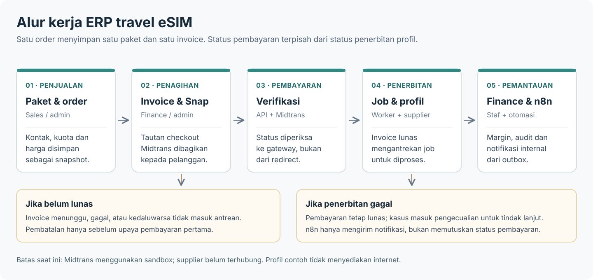
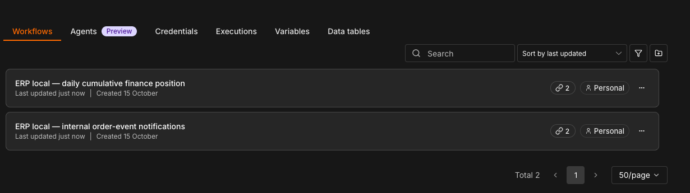
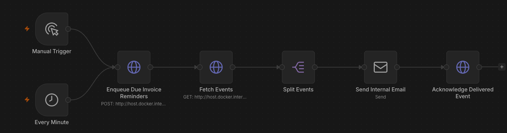
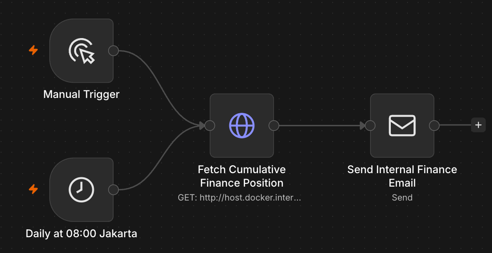
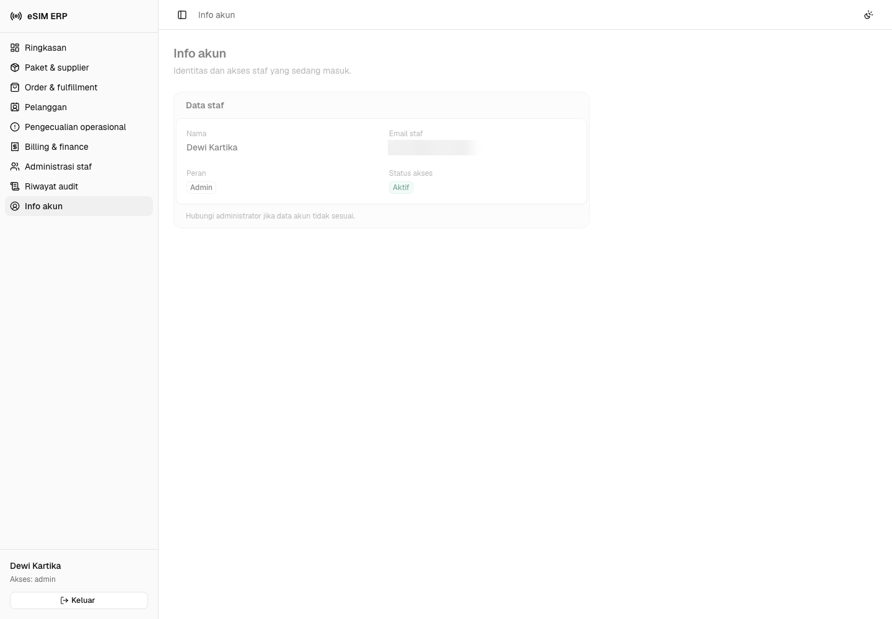
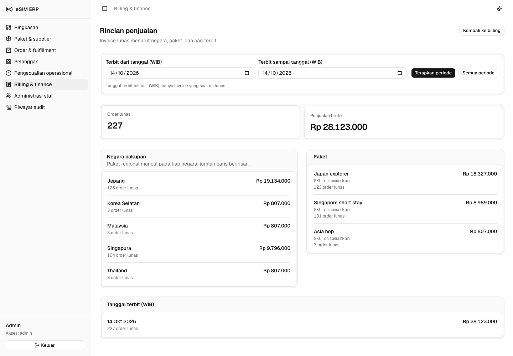
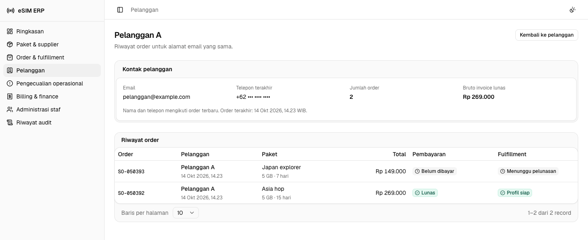
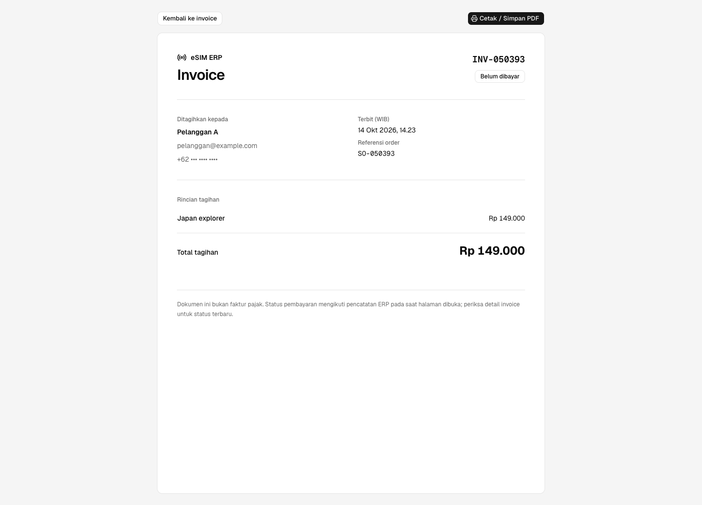
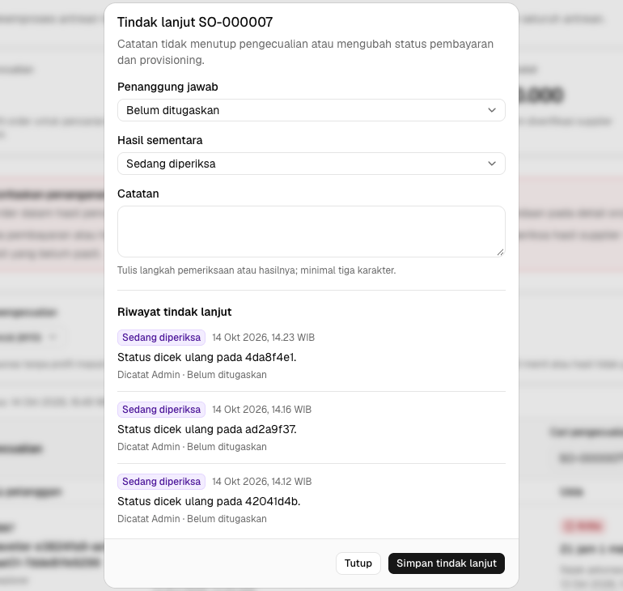
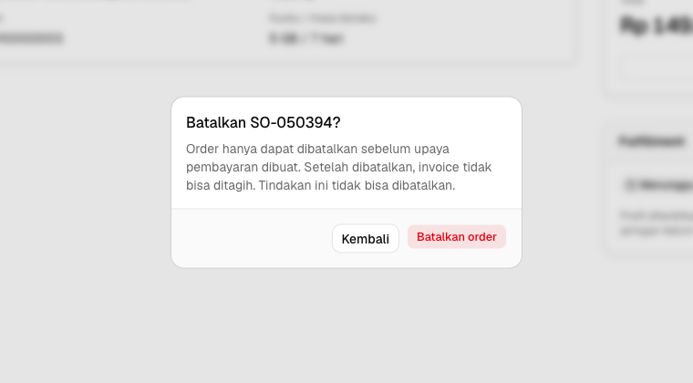

# ERP internal travel eSIM

Aplikasi untuk staf perusahaan telekomunikasi yang menjual paket internet eSIM
untuk perjalanan luar negeri. Staf mengelola paket, mencatat order, menagih
pembayaran, dan memantau penerbitan profil. Pelanggan tidak memiliki akun ERP;
payment link dibagikan oleh staf. Cakupan lengkap ada di [PRODUCT.md](PRODUCT.md).

## Modul

1. **Katalog & supplier:** cakupan negara, kuota, masa berlaku, biaya supplier,
   harga jual, dan sinkronisasi paket.
2. **Order & fulfillment:** order pelanggan, invoice otomatis, antrean penerbitan
   profil, serta tindak lanjut jika penerbitan gagal.
3. **Billing & finance:** payment link, status pembayaran, biaya supplier,
   ringkasan penjualan, ekspor CSV, dan invoice siap cetak.

Fitur pendukung: direktori pelanggan, empat peran staf (admin, sales,
operations, finance), info akun, undangan staf, dan riwayat audit.

## Hak akses staf

Semua staf yang masuk dapat melihat ringkasan, katalog, daftar dan detail order,
pengecualian operasional, serta info akunnya. Menu mengikuti peran, tetapi API
tetap memeriksa izin; tindakan tanpa hak akses ditolak dengan `403`.

- **Admin:** mengelola staf (undangan, peran, penonaktifan) dan riwayat audit,
  mengatur harga paket, serta menjalankan tindakan penjualan, operasional, dan
  billing.
- **Sales:** membuat dan membatalkan order sebelum ada percobaan pembayaran,
  melihat direktori pelanggan, serta membuka info pemasangan profil yang siap.
- **Operations:** menyinkronkan katalog, memproses antrean penerbitan, mencoba
  ulang penerbitan yang gagal bila aman, membuka info pemasangan, dan mencatat
  tindak lanjut pengecualian.
- **Finance:** mengelola invoice dan payment link, merekonsiliasi pembayaran
  Midtrans, mencatat penyesuaian keuangan, melihat laporan, dan menindaklanjuti
  pengecualian. Admin dan finance dapat mensimulasikan pelunasan jika
  `ALLOW_DEMO_PAYMENTS=true`, sesuai batasan pada bagian Payment Gateway.

Direktori pelanggan hanya untuk admin/sales; halaman invoice dan laporan
keuangan hanya untuk admin/finance. n8n memakai token automasi terpisah, bukan
akun staf.

## Integrasi

- **API Connection:** frontend Next.js (React) memanggil API internal Hono
  melalui proxy server; PostgreSQL menyimpan transaksi, dan kontrak Zod dipakai
  bersama. Adapter supplier saat ini memakai data lokal, **belum** terhubung
  ke penyedia layanan eSIM.
- **Payment Gateway:** Midtrans **Snap sandbox** menyediakan checkout hosted.
  Backend membuat payment link dan memeriksa status ke Midtrans sebelum
  mencatat pelunasan; redirect pelanggan bukan bukti bayar. Untuk meninjau
  alur tanpa transaksi gateway, admin/finance juga dapat memilih
  **Simulasikan pelunasan** pada invoice baru ketika `ALLOW_DEMO_PAYMENTS=true`.
  ERP memvalidasi invoice dan nominal, mencatat sumber simulasi di riwayat dan
  audit, lalu mengantrekan penerbitan profil. Ini **bukan** bukti dana masuk
  ataupun verifikasi Midtrans; setelah payment link dibuat, selesaikan dan
  periksa transaksi Midtrans, bukan gunakan simulasi. Pembayaran dari data awal
  juga tidak diverifikasi Midtrans. Lihat
  [hasil uji sandbox](docs/MIDTRANS-VERIFICATION.md) dan
  [dokumentasi Midtrans](https://docs.midtrans.com/).
- **Automation Tools:** n8n membaca event dari API internal, mengirim notifikasi
  staf, dan menjadwalkan laporan posisi keuangan. Di lokal, email menuju
  Mailpit, bukan pelanggan. [Panduan workflow](automation/n8n/README.md).

Profil dari supplier lokal tidak menyediakan layanan internet atau kode
instalasi yang dapat dipakai pelanggan. Pembayaran Midtrans hanya tersedia
melalui sandbox.

## Arsitektur dan alur



Browser staf → Next.js (sesi dan proxy) → API Hono → PostgreSQL. API berkomunikasi
dengan Midtrans sandbox untuk pembayaran; invoice lunas mengantrekan job
fulfillment. Event operasional dikirim ke n8n melalui API terbatas. Status
pembayaran dan status penerbitan profil disimpan terpisah.

Struktur utama: `apps/web` (frontend), `apps/api` (backend dan worker),
`packages/contracts` (skema bersama), `automation/n8n` (workflow), dan
`database` (PostgreSQL). Backend dapat berjalan sebagai Cloudflare Worker atau
image Bun.

Untuk Frontend, dideploy ke Vercel. Backend dideploy ke Cloudflare Worker. Database, Mailpit, dan N8N dideploy ke VPS internal.

## Instalasi dan menjalankan aplikasi

Prasyarat: Bun **1.3.11**, Node.js **24.21.0**, Moonrepo **2.0.4**, dan Docker
Compose. Versi tercatat di [`.prototools`](.prototools).

**Sebelum menjalankan:** `infra:up` memerlukan `compose.yaml` di root, tetapi
file tersebut belum ada pada checkout ini. Siapkan Compose lokal untuk
PostgreSQL pada port **55440**, n8n pada **5679**, dan Mailpit pada **8029**;
Compose database VPS di `database/` tidak memakai konfigurasi/port lokal yang
sama. Jangan jalankan migrasi atau seed terhadap database bersama. Setelah
Compose lokal siap, jalankan dari root repository:

```sh
bun install --frozen-lockfile
bun run setup:local
bun run infra:up
bun run db:migrate
bun run db:seed
bun run dev
```

`setup:local` membuat konfigurasi dan password acak tanpa menimpa file yang
sudah ada. Petunjuk login disimpan di `.amp/in/local-login.txt` (privat, jangan
di-commit). Seed mengisi data perjalanan **sintetis**. Jika ingin mencoba
payment link Snap, masukkan `MIDTRANS_SERVER_KEY` **sandbox** lewat editor ke
`apps/api/.dev.vars`, lalu restart API; jangan taruh key di frontend. Checkout
hosted tidak memerlukan Client Key frontend. Simulasi internal tersedia untuk
invoice tanpa upaya Midtrans ketika `ALLOW_DEMO_PAYMENTS=true` di backend, termasuk
`APP_ENV=production`; default Compose API nonaktif jika flag tidak diisi.
Simulasi juga menjadwalkan penerbitan profil, sehingga gunakan data dan supplier
pengujian, bukan order pelanggan sungguhan.

Setelah aplikasi berjalan:

- ERP: <http://localhost:3010/auth/login>
- API/OpenAPI: <http://localhost:3011/docs>
- n8n: <http://localhost:5679> · Mailpit: <http://localhost:8029>

Impor workflow ke **n8n lokal** dengan `bun run automation:import` setelah API
dan Compose berjalan. Untuk smoke test API, jalankan
`curl -fsS http://localhost:3011/health`; hasil yang diharapkan
`{"ok":true,"service":"esim-erp-api"}`. Health hanya memeriksa proses;
buka ringkasan setelah login untuk menguji koneksi database.

## Verifikasi

```sh
bun run verify
# Sesudah API, web, dan seed lokal tersedia:
bunx playwright install chromium --no-shell
bun run test:e2e
```

`verify` menjalankan lint, typecheck, tes API, dan build; `test:e2e` menguji
alur browser terhadap data lokal dan dapat menambah order sintetis serta
mencatat pelunasan simulasi. Keduanya tidak men-deploy aplikasi atau menagih
Midtrans. Untuk verifikasi **oleh Midtrans**, ikuti alur Snap dan simulator
resminya di [verifikasi Midtrans](docs/MIDTRANS-VERIFICATION.md).

## Pemasangan di perangkat

Web dapat dipasang melalui browser pada HTTPS atau localhost. Build frontend
(`bun run --cwd apps/web build`) menghasilkan service worker melalui
`@ducanh2912/next-pwa`. Cache hanya berisi aset aplikasi dan halaman pemberitahuan
offline; halaman staf, respons API, dan transaksi tetap membutuhkan jaringan.
Ketika navigasi halaman gagal karena koneksi terputus, browser menampilkan
**Koneksi terputus**. Fitur ini tidak memungkinkan order atau pembayaran offline.

## Tangkapan layar

**Ringkasan operasional**


**Billing & finance**


**Workflow n8n**



Notifikasi order (manual atau setiap menit): `POST /automation/reminders/enqueue`
membuat maksimal satu pengingat per invoice yang tetap belum lunas selama 24 jam.
`GET /automation/events` mengambil hingga 25 event; n8n mengirim email internal,
lalu `POST /automation/events/{id}/ack` **setelah SMTP berhasil**. Jika pengiriman
atau pengakuan gagal, event dapat dicoba lagi; notifikasi bisa terkirim lebih
dari sekali. [Definisi workflow](automation/n8n/order-events.json).



Posisi keuangan (manual atau pukul **08.00 WIB**): n8n membaca ringkasan kumulatif
melalui `GET /automation/finance-summary` dan mengirimnya ke email finance
internal. Angka tersebut bukan hanya penjualan hari berjalan; workflow ini tidak
membuat pembayaran. [Definisi workflow](automation/n8n/finance-position.json).



Gambar diambil dari dua workflow yang diimpor ke n8n lokal. Cara menjalankan dan
menguji pengiriman ada di [panduan otomasi](automation/n8n/README.md).

<details>
<summary>Screenshot fitur lainnya</summary>













</details>

## Dokumen lanjutan

- [Peta dokumentasi](docs/README.md) dan [cakupan produk](PRODUCT.md).
- [Verifikasi Midtrans](docs/MIDTRANS-VERIFICATION.md) dan
  [otomasi n8n](automation/n8n/README.md).
- [Runbook Compose VPS](docs/runbooks/vps-compose.md) dan
  [workflow image Docker](.github/workflows/images.yml).

## Alamat aplikasi

- Frontend: <https://esim-erp.ekel.dev>
- API: <https://esim-erp-api-production.haikel.workers.dev>

Keduanya dapat diakses, tetapi revisi lokal ini belum di-deploy ke alamat
tersebut. Respons `/health` API tidak membuktikan koneksi database.
