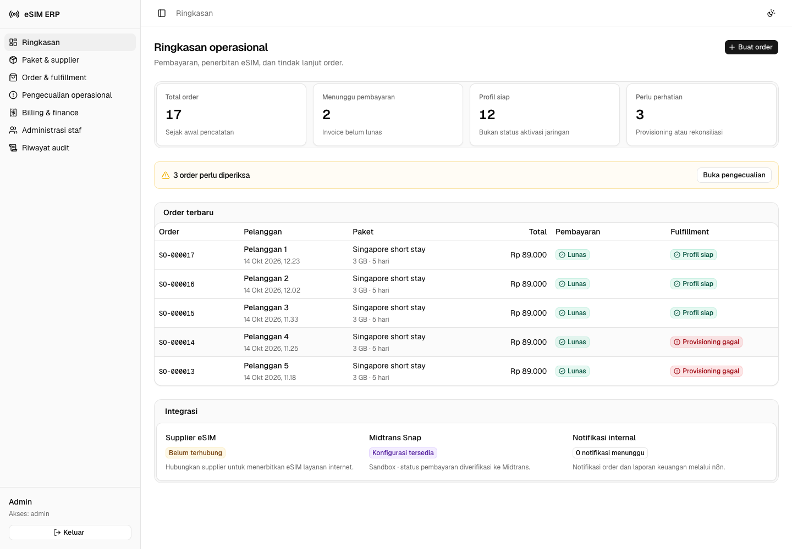
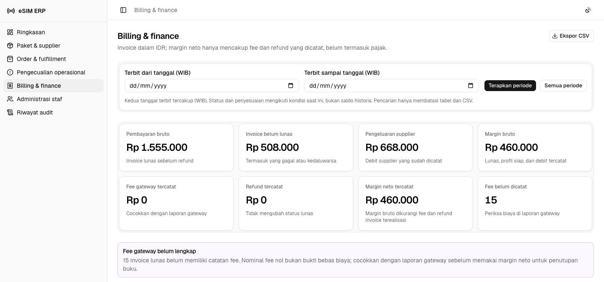

# ERP internal travel eSIM

ERP untuk staf perusahaan telekomunikasi yang menjual paket internet eSIM
perjalanan internasional. Staf mengelola katalog, mencatat order pelanggan,
menagih pembayaran, menerbitkan profil, dan memantau biaya supplier.

**Ini bukan e-commerce.** Tidak ada storefront, keranjang, registrasi pelanggan,
atau checkout publik. Pelanggan hanya menerima payment link Midtrans yang
dibagikan staf. Scope dan asumsi ada di [PRODUCT.md](PRODUCT.md).

Repository Harness resmi telah dipasang tanpa mengganti panduan engineering
existing. Mulai dari [documentation map](docs/README.md); provenance,
pemeriksaan, dan recovery ada di [docs/HARNESS.md](docs/HARNESS.md).

## Status dan batas integrasi

- Area staf: katalog dan supplier, order dan fulfillment, pengecualian
  operasional, billing dan finance, administrasi staf, serta riwayat audit.
- Frontend Next.js, ReUI `base-nova`, Tailwind, TanStack Query/Table, dan satu
  transisi halaman Framer Motion. Backend Hono berjalan di Wrangler/Workers
  atau image Bun; PostgreSQL dan kontrak Zod digunakan bersama.
- **Supplier belum terhubung.** Katalog dan saldo lokal belum diverifikasi ke
  supplier. API yang dipilih perusahaan belum diberikan; profil fixture tidak
  menyediakan internet, sehingga UI tidak menampilkan QR atau kode instalasinya.
- **Midtrans Snap sandbox telah diverifikasi** melalui checkout hosted, BCA VA,
  simulator resmi, dan rekonsiliasi server: invoice Rp89.000 mencapai
  `settlement`. Bukti dan batasnya ada di
  [docs/MIDTRANS-VERIFICATION.md](docs/MIDTRANS-VERIFICATION.md).
  Tanpa Server Key, pembuatan payment link dinonaktifkan. UI tidak menyediakan
  kontrol pelunasan fixture atau pilihan skenario supplier.
- n8n menjalankan notifikasi internal berbasis outbox dan email posisi keuangan
  kumulatif. Workflow lokal dapat mengirim satu pengingat setelah invoice belum
  lunas selama 24 jam ke alamat internal sintetis melalui **Mailpit**, bukan ke
  pelanggan atau penerima nyata.
- Billing memiliki filter periode tanggal terbit invoice (WIB), ekspor CSV,
  rincian penjualan lunas menurut negara/paket/hari, cetak/simpan PDF melalui
  browser, serta pencatatan fee gateway dan refund manual. Catatan refund
  **tidak** mengirim pengembalian dana ke Midtrans.
- Direktori pelanggan menyatukan kontak berdasarkan email tanpa mengubah
  snapshot order; pengecualian memiliki penanggung jawab dan riwayat tindak
  lanjut. Order tanpa upaya pembayaran dapat dibatalkan oleh sales/admin.
- Satu perusahaan, satu supplier, IDR, dan satu paket/profil per order. Belum ada
  top-up, refund otomatis, aktivasi/usage jaringan, multi-currency, jurnal umum,
  pajak, payroll, atau integrasi supplier produksi.
- Target hosting: Vercel untuk web, Cloudflare Workers untuk API, PostgreSQL
  dan n8n di VPS. Alamat live yang diberikan: frontend
  **<https://esim-erp.ekel.dev>** dan backend
  **<https://api.esim-erp.ekel.dev>**. Deployment revisi repository ini pada
  kedua alamat tersebut **belum diverifikasi**. Image Docker tersedia sebagai
  alternatif hosting, bukan bukti deployment.

## Tampilan ERP

Tangkapan layar dari stack lokal dengan data sintetis; nama pelanggan
disamarkan. Angka dan status di sini bukan laporan keuangan atau layanan eSIM
live. Midtrans masih sandbox dan supplier belum terhubung.

**Ringkasan operasional**



**Billing dan finance**



## Menjalankan lokal

Prasyarat: Git, Bun **1.3.11**, Node **24.21.0**, Moonrepo **2.0.4**, dan Docker
Compose. Versi tooling ada di `.prototools`; gunakan `proto install` bila proto
tersedia, atau pasang versi tersebut melalui pengelola tooling Anda.

Jalankan dari root repository:

```sh
bun install --frozen-lockfile
bun run setup:local
bun run infra:up
bun run db:migrate
bun run db:seed
bun run dev
```

Jika PostgreSQL belum siap, tunggu status `healthy` di `docker compose ps`, lalu
ulangi migrasi. Alternatif untuk dua terminal terpisah:

```sh
moon run api:dev
moon run web:dev
```

Jika checkout tidak memiliki Git `HEAD`, Moonrepo membutuhkan commit pertama;
gunakan `bun run --cwd=apps/api dev` dan `bun run --cwd=apps/web dev` sebagai
pengganti dua perintah Moon di atas.

Akses lokal:

- ERP: <http://localhost:3010/auth/login>.
- Dokumentasi OpenAPI: <http://localhost:3011/docs>.
- n8n lokal: <http://localhost:5679>.
- Inbox Mailpit: <http://localhost:8029>.
- PostgreSQL: loopback port **55440**, bukan port PostgreSQL default.

Gunakan **localhost**, bukan `127.0.0.1`, untuk URL web: mutasi dilindungi
pemeriksaan origin dan konfigurasi lokal menggunakan `http://localhost:3010`.

`setup:local` menghasilkan rahasia acak dan enam file berizin `600`. Ia juga
menambahkan `/.amp/in/` ke Git **local exclude** sebelum menulis file privat.
Tidak ada password tetap dalam source. Petunjuk login ada di
`.amp/in/local-login.txt`; jangan commit atau bagikan isinya.

Akun sintetis: `admin@demo.invalid`, `sales@demo.invalid`,
`operations@demo.invalid`, dan `finance@demo.invalid`. Password lokal dihasilkan
saat setup. Setup tidak menimpa konfigurasi yang sudah ada; konfigurasi parsial
harus dipulihkan, bukan direset. Seed mempertahankan order, saldo, dan akun
yang sudah ada.

## Alur operasional

1. **Admin/operations** membuka Paket & supplier dan memilih **Perbarui katalog**.
   Admin dapat mengubah harga jual dan status tersedia. Pembaruan tidak
   menimpa keputusan harga jual atau status aktif.
2. **Sales/admin** membuat order dengan kontak pelanggan dan paket. Server
   membuat invoice dari harga katalog dan menyimpan snapshot paket. Direktori
   pelanggan menampilkan riwayat per email; sebelum ada **upaya pembayaran
   apa pun**, sales/admin dapat membatalkan order dan invoice-nya.
3. **Finance/admin** membuka invoice, membuat payment link Midtrans Snap, dan
   membagikannya kepada pelanggan. **Periksa status Midtrans** membaca status
   langsung dari gateway; redirect browser tidak menjadi bukti pelunasan.
   **Cetak / Simpan PDF** membuka dokumen invoice terkini dan dialog cetak
   browser; bukan PDF atau faktur pajak yang dibuat server.
4. Invoice lunas membuat job provisioning. **Periksa kode instalasi** tersedia
   bagi admin, sales, atau operations saat profil tercatat siap. Tanpa integrasi
   supplier layanan internet, panel menampilkan **Instalasi belum tersedia**.
5. Worker memproses antrean setiap menit (Workers Cron atau proses Docker
   terpisah). Operations/admin memeriksa inbox pengecualian dan hanya mencoba
   ulang kegagalan yang diketahui aman. Admin/operations/finance dapat mencatat
   penanggung jawab, hasil sementara, dan catatan tindak lanjut; catatan tidak
   menutup pengecualian. Invoice lunas tidak berarti profil siap.
6. Setelah profil berhasil, saldo supplier tercatat berkurang dan margin bruto
   muncul. Finance dapat melihat rincian penjualan, mencatat fee/refund dari
   bukti terpisah; n8n mengirim notifikasi internal dan melakukan acknowledgement.

Seed awal menyediakan enam paket dan lima order sintetis dengan status belum
dibayar, profil siap, dan provisioning gagal. Pembayaran fixture tetap berlabel
**Belum diverifikasi Midtrans**, bukan transaksi Snap. Masa berlaku mengikuti
aturan paket: **koneksi pertama ke jaringan**, bukan pembuatan order. ERP tidak
mengklaim dapat mengetahui apakah profil sudah dipasang atau aktif.

## Pembagian role

Semua staf dapat membaca katalog, order, dan ringkasan operasional. Izin mutasi
diterapkan di backend, bukan hanya disembunyikan di navigasi.

- **Admin:** seluruh operasi yang tersedia.
- **Sales:** membuat order dan membuka instalasi profil yang siap; tanpa akses
  billing/finance, perubahan katalog, atau retry provisioning. Sales/admin dapat
  melihat direktori pelanggan dan membatalkan order sebelum payment attempt.
- **Operations:** sinkronisasi katalog, pemrosesan/retry provisioning, dan
  instalasi; tanpa perubahan harga atau billing/finance.
- **Finance:** invoice, payment link, rekonsiliasi, dan laporan finance;
  tanpa membuat order atau mengakses kode instalasi.

Admin, operations, dan finance dapat mencatat tindak lanjut pada pengecualian
yang masih aktif dan memilih penanggung jawab dari staf aktif. Sales hanya
dapat membaca inbox pengecualian. Hanya admin/finance dapat membuka invoice
untuk dicetak dan melihat rincian penjualan; catatan dan perubahan status
tetap mengikuti izin backend.

Admin dapat mengundang staf melalui tautan akses sekali pakai, mengganti role,
menonaktifkan akses, dan menerbitkan tautan reset kata sandi. Perubahan akses
mencabut sesi aktif dan dicatat dalam audit; tautan harus dibagikan melalui
kanal privat. Tidak ada pendaftaran pelanggan atau staf secara publik.

## Arsitektur yang berjalan

```diagram
┌───────────────────────┐       ┌──────────────────────────┐
│ Browser staf          │──────▶│ Next.js: pages + proxy   │
│ React Query / ReUI    │       │ HttpOnly staff cookie    │
└───────────────────────┘       └────────────┬─────────────┘
                                           │ Proxy key + staff session
                                           ▼
┌───────────────────────┐       ┌──────────────────────────┐
│ Midtrans sandbox      │◀─────▶│ Hono / Cloudflare Workers│
│ Snap + status + webhook│      │ Auth + domain use cases  │
└───────────────────────┘       └────────────┬─────────────┘
                                           │ PostgreSQL transactions
                                           ▼
┌───────────────────────┐       ┌──────────────────────────┐
│ Supplier fixture lokal│◀──────│ Jobs + profiles + wallet │
│ No external purchase  │       │ Invoices + outbox        │
└───────────────────────┘       └────────────┬─────────────┘
                                           │ Restricted automation API
                                           ▼
┌───────────────────────┐       ┌──────────────────────────┐
│ Mailpit (local SMTP)  │◀──────│ n8n workflows            │
└───────────────────────┘       └──────────────────────────┘
```

Di deployment non-lokal, koneksi **Workers** ke PostgreSQL harus melalui
**Cloudflare Hyperdrive**. Image **Bun** menggunakan `DATABASE_URL` saat runtime;
API HTTP dan worker antrean adalah dua peran proses terpisah dari image yang
sama (`bun /app/server.js` dan `bun /app/server.js --worker`). Lokal menggunakan
PostgreSQL Compose secara langsung. Setiap request/job menutup koneksi database
setelah selesai; Hyperdrive menangani pooling di Workers.

Struktur penting:

```text
apps/web/src/app/                route /auth/*, /app/*, dan proxy privat
apps/web/src/components/         shell dan komposisi fitur ReUI
apps/web/src/services/           transport bertipe + validasi respons
apps/web/src/hooks/              React Query dan invalidasi per resource
apps/api/src/http/               Hono routes, auth, OpenAPI, error boundary
apps/api/src/modules/            business rules dan repository contracts
apps/api/src/infrastructure/     PostgreSQL, crypto, supplier, Midtrans
apps/api/migrations/             skema PostgreSQL dari Drizzle
packages/contracts/src/         kontrak request/response Zod bersama
automation/n8n/                  dua workflow tanpa rahasia
scripts/                        setup lokal dan importer n8n terjaga
.moon/                          orkestrasi monorepo
```

### Batas transaksi dan keamanan

- Session token acak disimpan sebagai hash; cookie browser `HttpOnly`,
  `SameSite=Lax`, dan `Secure` pada origin HTTPS. Password memakai scrypt.
- Browser tidak menerima proxy secret, automation token, Server Key Midtrans,
  atau encryption key. Next.js mengizinkan hanya endpoint staf tertentu;
  automation/webhook tidak dapat dipanggil melalui proxy browser.
- Kode instalasi dienkripsi AES-GCM, diminta terpisah dari detail order, dan
  aksesnya dicatat dalam audit. Payload n8n tidak memuat kontak pelanggan atau
  kode instalasi.
- Invoice dikunci saat mengubah pembayaran. Hanya satu payment attempt aktif
  per invoice. Status lunas tidak turun akibat notifikasi terlambat. Pembatalan
  mengunci invoice yang belum pernah memiliki attempt (juga menolak attempt
  yang sudah gagal atau kedaluwarsa) dan mencegah tagihan baru; ini bukan refund.
- Invoice lunas, job provisioning, dan event outbox commit bersama. Claim job
  menggunakan lease dan `SKIP LOCKED`; profil, debit supplier, saldo wallet,
  status job, dan event berhasil commit bersama.
- Retry otomatis lease hanya aman untuk adapter fixture saat ini. Supplier asli
  wajib memiliki idempotency key/status lookup sebelum recovery purchase
  boleh digunakan. Hasil purchase yang tidak pasti tidak boleh diulang buta.
- Fee gateway dan refund dari bukti eksternal dicatat terpisah. Pencatatan tidak
  memanggil refund gateway, mengubah status lunas, atau membalik debit supplier.
  Chargeback/charge ganda tetap perlu rekonsiliasi manual.
- API membatasi body 64 KB, pagination 50 record, login 10 percobaan per email
  per menit, dan Workers rate limit 120 request per IP per menit. Requests dari
  proxy berbagi alamat keluar server; ini batas sederhana untuk MVP internal,
  bukan klaim isolasi rate limit setiap staf.
- Compression dimiliki **Cloudflare Workers**, termasuk Wrangler. Middleware
  compression Hono sengaja tidak dipasang ganda karena transport Workers
  sudah mengelola encoding respons.

### Arti angka finance

`paidGrossIdr` adalah jumlah bruto invoice lunas. `outstandingIdr` mencakup
invoice belum lunas, termasuk gagal/kedaluwarsa, tetapi **tidak** order yang
dibatalkan. `supplierSpendIdr` adalah debit supplier yang sudah dicatat.
Margin bruto hanya dihitung untuk invoice
**lunas + profil siap + debit supplier**. Margin neto tercatat mengurangi fee
dan refund yang dicatat pada invoice tersebut; fee yang belum dicatat tidak
dianggap nol. Filter periode memilih **tanggal terbit invoice** (inklusif, WIB),
namun memakai status dan penyesuaian terkini, bukan rekonstruksi saldo pada
akhir periode. Pencarian membatasi tabel dan CSV, tidak total ringkasan. Angka
ini bukan laba/rugi akuntansi lengkap atau saldo kas.

**Rincian penjualan** memakai periode yang sama, tetapi hanya invoice yang
saat ini lunas. Pengelompokan paket memakai snapshot SKU dan nama saat order;
hari memakai WIB. Paket regional masuk ke setiap negara cakupannya, jadi
**jangan menjumlahkan baris negara** untuk mendapatkan total penjualan.

## Midtrans sandbox

Referensi resmi: <https://docs.midtrans.com/>.

Tambahkan `MIDTRANS_SERVER_KEY` **sandbox** ke `apps/api/.dev.vars` melalui
editor lokal, lalu restart Wrangler. Jangan menaruh key di frontend,
`NEXT_PUBLIC_*`, command arguments, source, atau screenshot. Snap redirect
tidak membutuhkan Client Key frontend dalam implementasi ini.

UI checkout tetap milik **Midtrans Snap**, bukan form pembayaran buatan ERP.
Backend menggunakan Server Key untuk membuat transaksi dan menerima
`redirect_url`; ERP hanya membagikan link. Merchant ID terikat pada credential
merchant tersebut. Client Key diperlukan jika frontend menggunakan popup
`snap.js` dengan `data-client-key`, bukan untuk link hosted yang digunakan ERP.

Adapter mengirim `POST https://app.sandbox.midtrans.com/snap/v1/transactions`.
Notifikasi masuk ke `POST /webhooks/midtrans`; signature diperiksa dengan
SHA-512 atas **order_id + status_code + gross_amount + Server Key** tanpa
mengubah representasi amount. Setelah itu server meminta status transaksi
langsung dari `https://api.sandbox.midtrans.com/v2/{order_id}/status`.
Order ID, currency IDR, amount invoice, dan transaction ID harus cocok.
`settlement`, atau `capture` dengan fraud `accept`, dapat melunasi invoice.
Callback browser/redirect tidak mengubah status paid.

Midtrans harus dapat mencapai webhook melalui HTTPS publik. Localhost tidak
dapat menerima notifikasi Midtrans. Checkout dan settlement sandbox dengan
credential merchant telah dijalankan; status direkonsiliasi melalui ERP dan
GET Status API. **Delivery webhook otomatis dari Midtrans belum diverifikasi.**
Endpoint HTTPS dan pengaturan merchant membutuhkan persetujuan terpisah.
Hasil, screenshot, dan langkah mengulang ada di
[verifikasi Midtrans](docs/MIDTRANS-VERIFICATION.md).

## n8n lokal

Dengan API dan Compose sudah berjalan:

```sh
bun run automation:import
```

Importer memverifikasi versi/container/checkout lokal, credential privat,
ownership, personal project, dan koneksi Docker ke API. Pada instance kosong,
ia membuat owner sintetis melalui first-run setup n8n; ia tidak mereset owner
atau mengganti credential yang sudah ada. Jadwal dipublish dan hanya n8n lokal
direstart. Password owner diturunkan dari konfigurasi privat, tidak dicetak.

- `order-events.json`: setiap menit, antrekan invoice yang telah 24 jam belum
  lunas lalu fetch event, kirim email internal, dan ack **setelah SMTP berhasil**.
  Satu event pengingat per invoice berlaku hanya pada stack lokal tanpa kontak
  pelanggan; pelunasan, pembatalan, atau rekonsiliasi menekan reminder pending.
  Kegagalan SMTP meninggalkan event pending. Delivery at-least-once; crash/ack
  gagal atau overlap dapat menyebabkan email duplikat.
- `finance-position.json`: pukul **08:00 Asia/Jakarta**, email posisi keuangan
  **all-time kumulatif**, bukan penjualan harian.

Panduan impor, eksekusi manual, ownership, dan batas failure ada di
[automation/n8n/README.md](automation/n8n/README.md). n8n tidak memutuskan paid
atau membeli profil; keputusan tersebut milik backend.

## Verifikasi

```sh
bun run lint
bun run typecheck
bun run test
bun run build
bun run verify

# Jalankan API/web + seed terlebih dahulu.
bunx playwright install chromium --no-shell
bun run test:e2e
```

Jika Git `HEAD` belum ada, `lint` dan `test` tetap berjalan dari root. Jalankan
typecheck dan build tanpa orkestrasi Moon sebagai berikut:

```sh
bunx tsc --noEmit
bun run --cwd=packages/contracts typecheck
bun run --cwd=apps/api typecheck
bun run --cwd=apps/web typecheck
bun run --cwd=apps/api build
bun run --cwd=apps/web build
```

`test` mencakup kontrak Midtrans dan integrasi API/PostgreSQL. Ia hanya menerima
database **esim_erp_test** pada loopback **55440** dengan `APP_ENV=local`, membuat
database test bila belum ada, dan menjalankan migrasi. Tidak ada `DROP`,
`TRUNCATE`, atau penghapusan order existing. Fixture test bersifat sintetis dan tidak
menggunakan merchant/supplier nyata.

`test:e2e` menguji browser Chromium terhadap stack lokal yang berjalan: login,
cookie/session, role, undangan/reset staf dan pencabutan sesi, audit, order,
antrean/retry supplier, pembayaran fixture yang belum diverifikasi Midtrans,
pemeriksaan instalasi tanpa QR non-layanan, pencarian, error/retry UI, dark mode,
dan navigasi mobile. Tes API juga mencakup pembatalan bersaing dengan pembayaran,
direktori pelanggan, rincian penjualan, tindak lanjut, dan reminder lokal.
Ia menambahkan order sintetis melalui API lokal yang dijaga environment;
tidak membuat charge Midtrans. Screenshot review disimpan di
`.amp/in/artifacts/`; trace dinonaktifkan agar tidak merekam credential.

`build` menjalankan Next.js production build dan **Workers dry-run bundle**;
perintah tersebut tidak melakukan deploy. E2E lokal bukan verifikasi Vercel,
Hyperdrive/VPS, webhook publik, jaringan eSIM, atau seluruh browser.

Smoke test:

```sh
curl -fsS http://localhost:3011/health
```

Hasil yang diharapkan: `{"ok":true,"service":"esim-erp-api"}`. Setelah login,
buka halaman operasional dan buat order lokal untuk menguji koneksi database,
bukan hanya process health.

## Image Docker dan CI/CD

[`images.yml`](.github/workflows/images.yml) memverifikasi lint, typecheck,
dan pengujian API/PostgreSQL sebelum membangun dan menerbitkan **dua image** ke
`ghcr.io/<owner>/<repo>/frontend` dan `ghcr.io/<owner>/<repo>/backend`.
Setiap push ke `dev` mendapat tag `dev` dan `sha-<full-commit-sha>`; push ke
`main` mendapat `main`, `latest`, dan `sha-<full-commit-sha>`. `latest` tidak
berasal dari `dev`. Publikasi membutuhkan GitHub Actions dengan izin Packages
write; workflow di repository **belum dijalankan atau diverifikasi di GHCR**.
Image tidak men-deploy Vercel, Cloudflare Workers, database, atau n8n.

Image frontend menjalankan Next.js standalone (port 3010) dengan `API_ORIGIN`,
`WEB_ORIGIN`, dan `ERP_PROXY_SECRET` **saat runtime**, bukan saat build. Image
backend menggunakan port 3011 untuk HTTP; gunakan image **yang sama** pada
proses kedua dengan argumen `--worker` untuk memproses antrean setiap menit.
HTTP tanpa worker atau worker tanpa HTTP tidak menggantikan keduanya. Jika API
dipasang sebagai Cloudflare Worker, Cron di `wrangler.jsonc` menangani antrean
dan image backend hanya menjadi alternatif hosting.

Sebelum rollout yang disetujui, backup database dan kunci enkripsi. Jalankan
runner migrasi satu kali dari **image backend dengan tag SHA yang akan dipasang**
(`bun /app/migrate.js`, `DATABASE_URL` melalui konfigurasi privat) pada koneksi
database yang sudah ditinjau; jangan jalankan seed lokal atau migrasi otomatis
saat startup. Migrasi 0001 memakai `ALTER TABLE` dan `CREATE INDEX` tanpa
`CONCURRENTLY`; keduanya dapat menahan operasi tulis dan durasinya pada data
target belum diukur. Migrasi 0002 menambah nilai enum status/event, kolom
`cancelled_at`, tabel catatan tindak lanjut, dan indeks email kontak;
`ALTER TABLE`/`CREATE INDEX` dapat menahan operasi tulis, durasinya pada data target
belum diukur, dan nilai enum PostgreSQL tidak dapat ditarik mundur dengan
rollback aplikasi biasa. Uji pada salinan, jadwalkan saat trafik rendah, dan
bila gagal periksa jurnal migrasi serta backup sebelum mencoba lagi.

Konfigurasi backend mencakup `APP_ENV=production`,
`WEB_ORIGIN=https://esim-erp.ekel.dev`, `DATABASE_URL` (khusus Bun),
`ERP_PROXY_SECRET`, `ESIM_ENCRYPTION_KEY`, `AUTOMATION_TOKEN`, dan
`ALLOW_DEMO_PAYMENTS=false`. Adapter Midtrans saat ini **hanya memakai endpoint
sandbox**; `MIDTRANS_SERVER_KEY` harus berupa Server Key sandbox. Jangan gunakan
production key atau payment link ini untuk penagihan live. Pembayaran live
memerlukan perubahan endpoint dan verifikasi merchant terpisah; `APP_ENV` tidak
mengubah endpoint Midtrans.
Workers memakai Hyperdrive dan secret Workers, bukan fallback `DATABASE_URL`.
Konfigurasi frontend mencakup `API_ORIGIN=https://api.esim-erp.ekel.dev`,
`WEB_ORIGIN=https://esim-erp.ekel.dev`, dan proxy secret **yang sama**.

Urutan rollout: migrasi yang disetujui → API dan worker/Cron → cek health,
role, dan status transaksi → frontend. Setelah pembatalan pertama tercatat,
versi backend lama tidak mengenali status `cancelled`; **jangan rollback langsung
ke image lama**. Pertahankan layanan pada versi baru atau siapkan rilis
kompatibilitas yang dapat membaca status baru sebelum rollback aplikasi. Skema
dan riwayat catatan tetap ada; memulihkan backup berarti mempertimbangkan data
yang tercipta sesudahnya. Tag `dev`, `main`, dan `latest` berubah saat push
berikutnya dan tidak cocok untuk rollback yang dapat diaudit.

## Persiapan deployment dan recovery

Deploy memerlukan persetujuan dan akses terpisah. Jangan menjalankan migrasi
lokal atau seed fixture terhadap database bersama. Konfigurasi
`wrangler --env sandbox` sudah menetapkan staging dan menonaktifkan simulasi,
tetapi origin dan binding Hyperdrive **belum dikonfigurasi untuk lingkungan nyata**.

Sebelum layanan publik: pasang origin HTTPS frontend pada Workers, sinkronkan
proxy secret privat, pasang Hyperdrive ke PostgreSQL VPS dengan TLS dan akses
terbatas, secret Workers, encryption key persisten, backup PostgreSQL, serta
workflow n8n dengan recipient internal yang disetujui. Setelah rehearsal
migrasi yang disetujui, uji status + webhook Midtrans, validasi role, dan
observability. Jangan memakai akun atau recipient fixture untuk produksi.

Backup database **dan** encryption key harus dipulihkan bersama agar kode
instalasi dapat didekripsi. Pertahankan n8n volume dan encryption key yang cocok.
Jangan memakai `docker compose down -v` sebagai troubleshooting: itu menghapus
database dan workflow lokal. Untuk menghentikan stack tanpa menghapus volume,
gunakan `docker compose stop`; untuk melanjutkan, gunakan `bun run infra:up`.

Masalah umum:

- **403 invalid origin:** buka web lewat localhost sesuai `WEB_ORIGIN`.
- **API/configuration 503:** jalankan setup, pastikan API/PostgreSQL hidup, dan
  jangan mengisi optional Midtrans key dengan string kosong.
- **PostgreSQL belum sehat/port sibuk:** periksa `docker compose ps` dan port
  55440; jangan mengganti volume atau password existing secara sepihak.
- **n8n importer ditolak:** baca error ownership/version/configuration dan
  pulihkan file yang cocok; jangan reset instance atau turunkan izin credential.
- **Supplier gagal tetapi invoice lunas:** buka order dan retry sebagai
  operations/admin hanya bila failure diketahui belum menerbitkan profil.
- **Payment link belum pasti:** rekonsiliasi ke Midtrans; jangan membuat attempt
  baru atau mengganti sumber menjadi simulasi.
