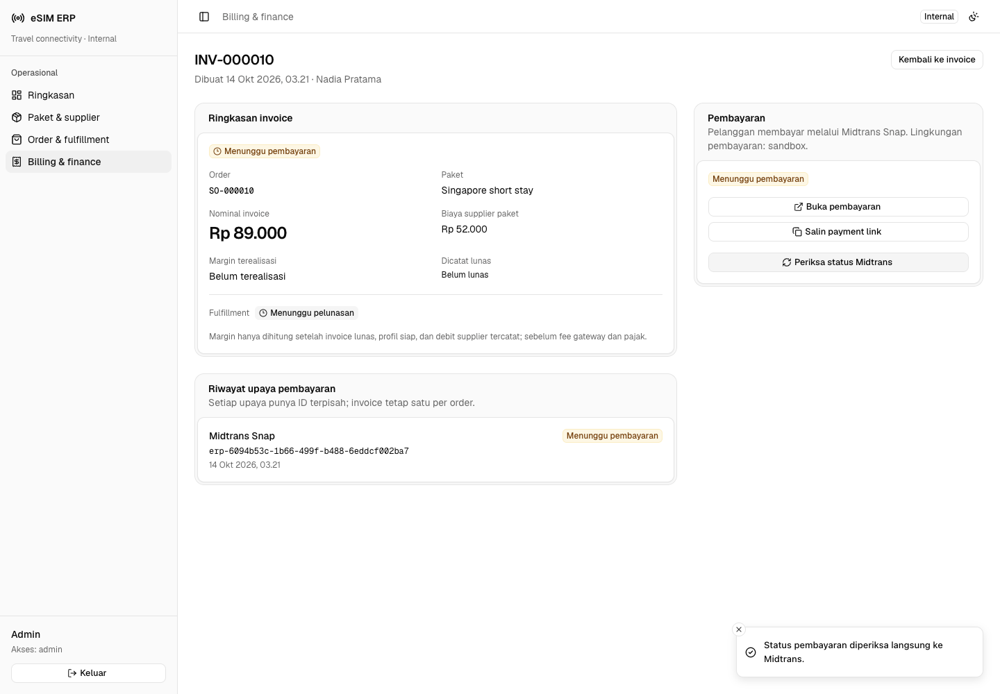
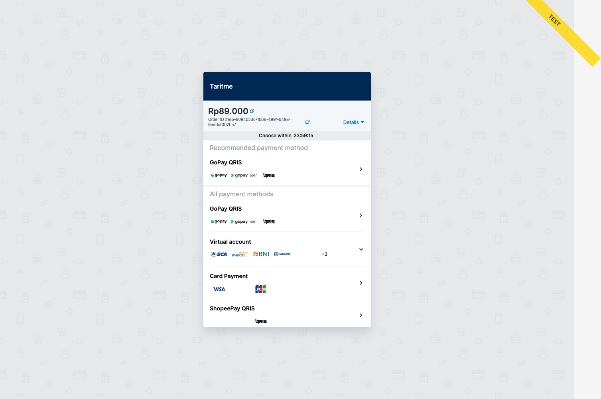
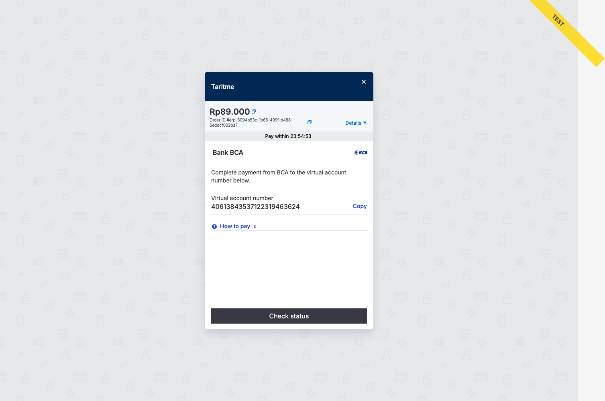
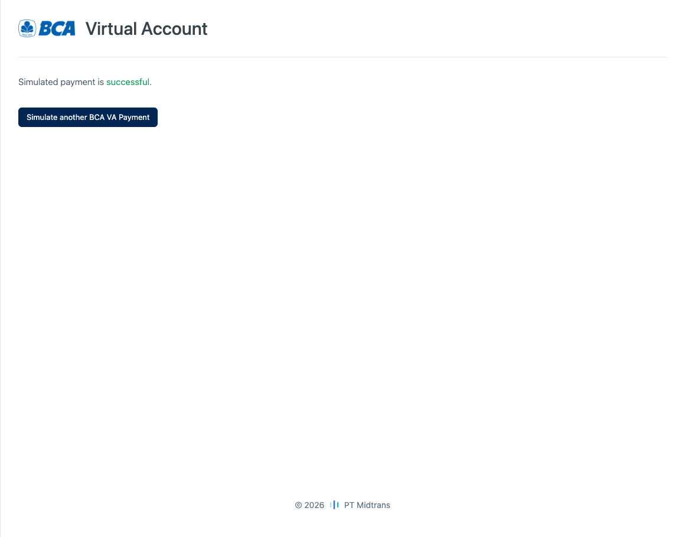
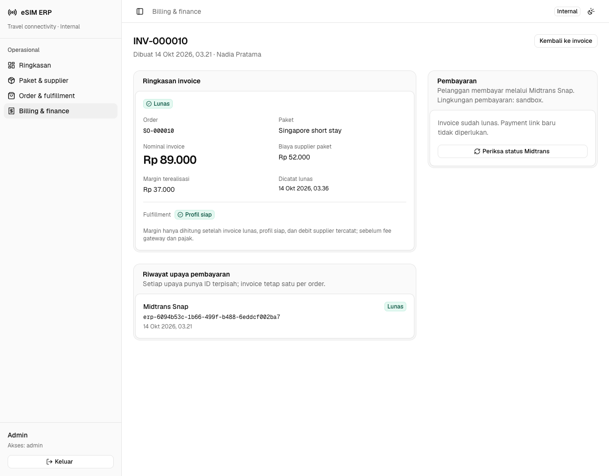
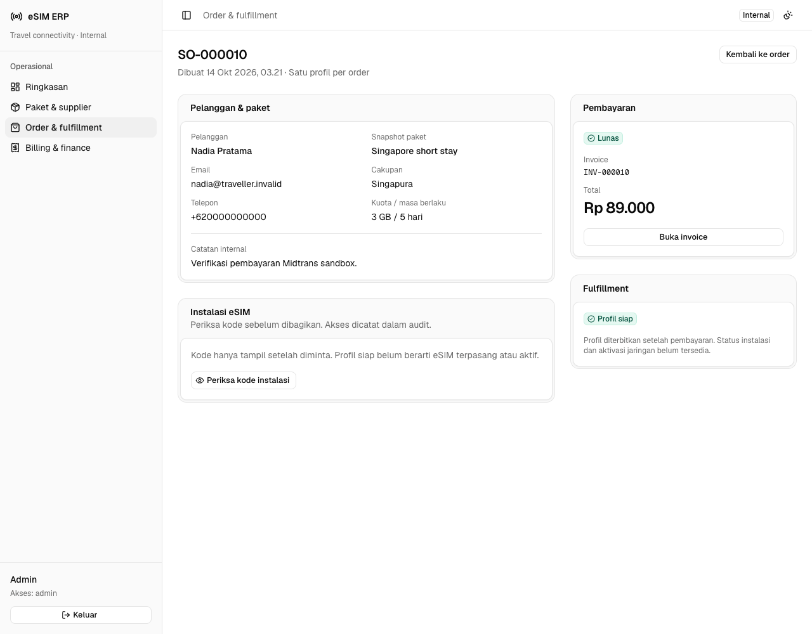
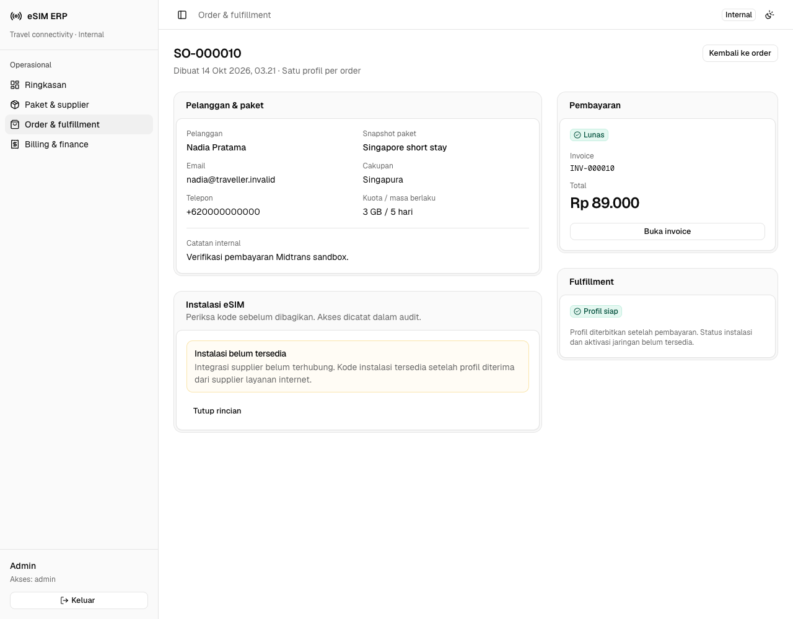

# Verifikasi Midtrans Snap

**Hasil:** checkout hosted Snap sandbox untuk **INV-000010 / SO-000010**,
nominal **Rp89.000**, mencapai **`settlement`** melalui BCA virtual account.
ERP merekonsiliasi status langsung ke Midtrans dan mempertahankan satu job
provisioning serta satu debit supplier lokal setelah request duplikat.

Verifikasi settlement: **13 Oktober 2026, 20:36 UTC / 14 Oktober 2026,
03:36 WIB**. Screenshot ERP setelah perapian copy diambil kembali dari invoice
yang sama; halaman pending dan simulator adalah capture historis saat pembayaran.

## Lingkungan dan batas pengujian

- Web lokal: `http://localhost:3010`; API: `http://localhost:3011`;
  PostgreSQL disposable lokal pada loopback port 55440.
- Endpoint Snap: `https://app.sandbox.midtrans.com/snap/v1/transactions`.
  Endpoint status: `https://api.sandbox.midtrans.com/v2/{order_id}/status`.
- Server Key sandbox yang disediakan pengguna disimpan privat di
  `apps/api/.dev.vars`. Tidak ada key, password, session token, atau payment
  bearer URL dalam dokumentasi dan screenshot ini.
- UI checkout dimiliki Midtrans; nama merchant yang terlihat adalah **Taritme**.
  ERP membagikan `redirect_url`, bukan membuat form transfer/kartu sendiri.
  Hosted redirect hanya memerlukan Server Key di backend. Popup `snap.js`
  memerlukan Client Key pada `data-client-key`; popup tersebut tidak digunakan.
- Nama/kontak pelanggan adalah fixture, bukan data pelanggan nyata. Supplier
  belum terhubung; provisioning dan debit di bawah berasal dari adapter lokal,
  **bukan pembelian eSIM layanan internet**. QR non-layanan tidak ditampilkan.
- Tidak menggunakan dana production. Tidak membuka tunnel, mengubah merchant
  dashboard, menjalankan migrasi bersama, atau melakukan deployment.

**Belum dibuktikan:** delivery webhook otomatis dari Midtrans ke HTTPS publik,
purchase supplier asli, instalasi/aktivasi/jaringan mobile, transaksi production,
metode pembayaran lain, dan delivery email ke penerima production. Replay HTTP
bertanda tangan yang dibuat lokal bukan bukti delivery otomatis dari Midtrans.

**Bedakan dua simulasi:** tombol **Simulasikan pelunasan** di ERP hanya memvalidasi
invoice dan mencatat pembayaran internal tanpa transaksi gateway. Untuk
memverifikasi pembayaran **melalui Midtrans**, gunakan invoice baru, checkout
Snap sandbox, simulator resmi, lalu **Periksa status Midtrans** seperti alur di
bawah. Jangan jalankan simulasi internal pada invoice yang sudah memiliki upaya
Midtrans.

## Alur yang dijalankan

1. Staf membuat order paket Singapore short stay; server menetapkan invoice
   Rp89.000 dan snapshot biaya supplier Rp52.000.
2. **Buat payment link** membuat satu attempt melalui Snap API. Pengulangan
   request menggunakan attempt aktif yang sama, bukan transaksi baru.
3. **Buka pembayaran** membuka hosted Snap. BCA virtual account dipilih.
   Saat gateway `pending`, invoice belum lunas dan tidak ada job/profil/debit.
4. Nomor VA sandbox dimasukkan ke simulator resmi BCA Midtrans; aksi bayar
   dijalankan sekali. Simulator menampilkan **“Simulated payment is successful.”**
5. GET Status API secara independen mengembalikan `settlement`. Staf memilih
   **Periksa status Midtrans**; backend mencocokkan order ID, amount, currency,
   dan transaction ID sebelum melunasi invoice.
6. ERP mencatat satu job, profil fixture, dan debit Rp52.000. Reload browser
   mempertahankan invoice lunas. Pemeriksaan ulang dan replay lokal tidak
   mengubah waktu paid, jumlah job/profil/debit, margin, atau saldo lagi.

## Hasil dan bukti

Identitas untuk korelasi, bukan credential:

- Invoice: **INV-000010**; order: **SO-000010**.
- Midtrans order ID: `erp-6094b53c-1b66-499f-b488-6eddcf002ba7`.
- Transaction ID: `f2a162d9-1436-4dca-9d15-ba55b8047044`.
- Metode: BCA virtual account; status gateway akhir: `settlement`.

Observasi database dan endpoint ERP pada transaksi tersebut:

- **Pending:** satu attempt; nol job, profil, debit, dan margin baru.
- **Settlement:** invoice `paid`, fulfillment `ready`; tepat satu attempt,
  satu job, satu profil fixture, dan satu debit **Rp52.000**.
- Gross invoice lunas bertambah **Rp89.000**; supplier spend bertambah
  **Rp52.000**; margin terealisasi bertambah **Rp37.000** sebelum fee/pajak.
- Saldo lokal saat verifikasi: **Rp12.144.000 → Rp12.092.000**, turun satu kali
  Rp52.000. Ini saldo tercatat lokal, bukan saldo yang dibaca dari supplier asli.
  Skenario fixture berikutnya dapat mengubah saldo agregat secara terpisah.
- Notifikasi dengan signature palsu ditolak **403 `invalid_signature`**.
- Rekonsiliasi duplikat tetap stabil. Replay lokal dengan signature yang valid
  mendapat **200** tanpa job, profil, atau debit tambahan; reload tetap lunas.

Observasi tersanitasi tersedia sebagai
[snapshot pending](assets/midtrans/pending-checks.json) dan
[snapshot settlement](assets/midtrans/settlement-checks.json). Screenshot
membantu membaca alur; klaim status dan idempotensi berasal dari GET Status API,
respons ERP, serta pemeriksaan database, bukan gambar saja.

### Invoice menunggu pembayaran — capture historis

Nominal Rp89.000, margin belum terealisasi, fulfillment menunggu pelunasan,
dan satu attempt Midtrans Snap. Ini bukan status terkini invoice.

### Checkout hosted Snap — capture historis

Merchant Taritme, nominal Rp89.000, dan pilihan pembayaran milik Midtrans.
Pita **TEST** berasal dari sandbox Midtrans dan sengaja dipertahankan.

### BCA virtual account menunggu transfer — capture historis

Snap menampilkan instruksi BCA, nomor VA sandbox, dan tombol Check status.
Instruksi transfer saja tidak membuktikan settlement.

### Konfirmasi simulator resmi — capture historis

Halaman hasil menyatakan pembayaran simulasi berhasil. Halaman ini tidak
menampilkan nominal/order ID; korelasi transaksi ditentukan melalui status API
dan observasi di atas, bukan screenshot simulator.

### Invoice lunas — UI terbaru pada transaksi yang sama

Riwayat tetap **Midtrans Snap**; margin Rp37.000, profil tercatat siap, dan
status dapat diperiksa lagi ke gateway. Tidak ada label pembayaran fixture.

### Order setelah rekonsiliasi — UI terbaru

Pembayaran lunas dan profil tercatat siap tidak berarti perangkat sudah
terpasang atau aktif di jaringan.

### Pemeriksaan instalasi tanpa supplier layanan internet

Panel menyatakan **Instalasi belum tersedia**, tanpa QR, activation code,
ICCID siap instalasi, atau tombol salin. Ini batas integrasi, bukan gangguan Snap.

## Cara mengulang pengujian

Gunakan stack disposable lokal dan credential **sandbox**, bukan invoice
production. Persiapan runtime, private setup, seed, dan login mengikuti
[README ERP](../README.md). Jangan memulihkan test dengan menghapus volume atau
mengubah order yang sudah dibayar.

1. Isi `MIDTRANS_SERVER_KEY` sandbox melalui editor pada `apps/api/.dev.vars`,
   lalu restart hanya Wrangler lokal bila konfigurasi berubah. Jangan mencetak
   key atau memasukkannya ke command arguments/`NEXT_PUBLIC_*`.
2. Login sales/admin dan buat **order baru** dengan kontak `.invalid`. Login
   finance/admin untuk membuka invoice dan membuat payment link.
3. Buka hosted Snap, pilih BCA VA, lalu catat status pending melalui
   **Periksa status Midtrans** sebelum melakukan pembayaran.
4. Pada [simulator BCA sandbox](https://simulator.sandbox.midtrans.com/bca/va/index),
   gunakan VA dari transaksi baru dan jalankan aksi bayar sekali. Jika hasil
   tidak pasti, periksa status; jangan mengulang charge secara buta.
5. Kembali ke ERP, pilih **Periksa status Midtrans**, lalu verifikasi invoice
   lunas, margin, dan order. Periksa ulang/reload untuk memastikan jumlah debit
   dan provisioning tidak bertambah. Instalasi tetap belum tersedia tanpa
   supplier layanan internet.

### Menguji GoPay/QRIS di sandbox

Untuk GoPay/QRIS pada checkout Snap desktop, salin URL gambar QR ke
[QRIS Simulator Midtrans](https://simulator.sandbox.midtrans.com/v2/qris/index).
Di ponsel, GoPay sandbox diarahkan ke simulator web. Setelah pembayaran
simulasi berhasil, kembali ke invoice dan pilih **Periksa status Midtrans**.

`bun run test` dan `bun run test:e2e` memeriksa kontrak, role, dan fixture lokal;
mereka **tidak membuat pembayaran merchant**. Pengujian sandbox di atas dilakukan
terpisah. Jangan membayar ulang INV-000010 sebagai bagian pemeriksaan rutin.

Untuk membuktikan webhook otomatis, diperlukan endpoint HTTPS publik dan
pengaturan notification URL pada merchant sandbox. Perubahan tersebut perlu
persetujuan terpisah; setelah tersedia, ulangi dengan transaksi baru dan cek
delivery, signature, status gateway, serta idempotensi di endpoint
`POST /webhooks/midtrans`.

## Referensi resmi

- [Dokumentasi Midtrans](https://docs.midtrans.com/).
- [Snap integration guide: redirect dan snap.js](https://docs.midtrans.com/docs/snap-snap-integration-guide).
- [HTTP(S) notifications, SHA-512 signature, dan status verification](https://docs.midtrans.com/docs/https-notification-webhooks).
- [GET Transaction Status API](https://docs.midtrans.com/reference/get-transaction-status).
- [Pengujian sandbox dan simulator GoPay/QRIS](https://docs.midtrans.com/docs/testing-payment-on-sandbox).
- [Simulator QRIS sandbox](https://simulator.sandbox.midtrans.com/v2/qris/index).
- [Simulator BCA virtual account sandbox](https://simulator.sandbox.midtrans.com/bca/va/index).

Source implementasi: [adapter Midtrans](../apps/api/src/infrastructure/midtrans.ts),
[aturan billing](../apps/api/src/modules/billing/usecase.ts),
[HTTP/auth boundary](../apps/api/src/http/app.ts), dan
[kontrak bersama](../packages/contracts/src/index.ts).
